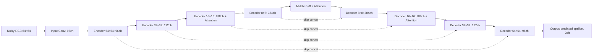

# 현재 diffusion teacher의 논문 및 구조 요약

기준: `teacher_b64_100k` 실험, 2026-09-28.
실제 [config](/root/workspace_distillation/configs/teacher/teacher_b64_100k.json)와
[모델 구현](/root/workspace_distillation/teacher/model.py)을 기준으로 작성했다.

## 1. 모델 개요

현재 모델은 **64×64 pixel-space class-conditional diffusion U-Net**이다.
Noisy RGB 이미지, diffusion timestep, 클래스 ID를 입력받아 추가된 Gaussian
noise를 예측한다. 모델 이름은 코드에서 `ClassConditionalUNet`이다.

DDPM의 학습 방식, OpenAI diffusion U-Net의 구조적 패턴, CFG의 null conditioning을
참고한 프로젝트 자체 구현이다. 논문의 특정 checkpoint나 전체 architecture를
그대로 재현했다고 주장하지 않는다. 모든 생성 모델 weight는 random initialization으로
학습하며, pretrained 생성 모델·VAE·외부 classifier를 사용하지 않는다.

| 항목 | 현재 구현 |
| --- | --- |
| 입력 | `x_t: [B,3,64,64]`, `t: [B]`, `class_id: [B]` |
| 출력 | `epsilon_pred: [B,3,64,64]` |
| 표현 공간 | RGB pixel, 이미지 범위 `[-1,1]` |
| 실제 클래스 | 151개, ID `0…150` |
| Null/unconditional ID | `151` |
| Parameter count | **48,883,107**, null embedding 포함 |
| 기본 채널 수 | 96 |
| 채널 multiplier | `(1,2,3,4)` |
| 전체 residual block | 22개 |
| 전체 self-attention block | 6개, single head |
| Downsample / upsample | 각각 3개 |

Parameter count와 block 수는 실제 model 객체를 생성해 확인했다. EMA는 같은
architecture의 weight 사본이며, inference에서는 선택한 weight 하나를 사용한다.

## 2. 참고 논문과 적용 범위

| 논문 | 이 프로젝트에서 참고한 부분 |
| --- | --- |
| [Denoising Diffusion Probabilistic Models — Ho, Jain, Abbeel, 2020](https://arxiv.org/abs/2006.11239) | Gaussian forward diffusion, epsilon prediction, noise MSE objective, DDPM 계열 sampling |
| [Diffusion Models Beat GANs on Image Synthesis — Dhariwal, Nichol, 2021](https://arxiv.org/abs/2105.05233) | Diffusion U-Net의 residual/attention 구성과 conditioning 패턴을 참고. 이 논문의 별도 classifier guidance는 구현하지 않음 |
| [Classifier-Free Diffusion Guidance — Ho, Salimans, 2022](https://arxiv.org/abs/2207.12598) | Class dropout, null condition, conditional/unconditional prediction 조합 |
| [Denoising Diffusion Implicit Models — Song, Meng, Ermon, 2020](https://arxiv.org/abs/2010.02502) | 같은 epsilon predictor를 사용하는 deterministic DDIM sampling 비교 |

구조를 비교할 수 있는 공개 구현은 OpenAI의
[U-Net](https://github.com/openai/guided-diffusion/blob/main/guided_diffusion/unet.py)과
[model configuration](https://github.com/openai/guided-diffusion/blob/main/guided_diffusion/script_util.py)이다.
현재의 96 base channels, single-head attention, EMA 두 개의 추적, 학습 예산과
augmentation은 프로젝트에서 정한 설정이다.

## 3. U-Net 전체 구조

Encoder feature를 저장한 뒤 decoder에서 **channel 방향으로 concatenate**한다.
입력 convolution 출력까지 포함해 decoder의 12개 residual block에 각각 skip feature가 연결된다.

| 구간 | 해상도 | 출력 채널 | ResBlock 수 | Attention |
| --- | --- | ---: | ---: | --- |
| 입력 3×3 convolution | 64×64 | 96 | — | 없음 |
| Encoder level 0 | 64×64 | 96 | 2 | 없음 |
| Encoder level 1 | 32×32 | 192 | 2 | 없음 |
| Encoder level 2 | 16×16 | 288 | 2 | 각 block 뒤 |
| Encoder level 3 | 8×8 | 384 | 2 | 없음 |
| Middle | 8×8 | 384 | 2 | 첫 block 뒤 1개 |
| Decoder level 3 | 8×8 | 384 | 3 | 없음 |
| Decoder level 2 | 16×16 | 288 | 3 | 각 block 뒤 |
| Decoder level 1 | 32×32 | 192 | 3 | 없음 |
| Decoder level 0 | 64×64 | 96 | 3 | 없음 |
| 출력 GroupNorm → SiLU → 3×3 convolution | 64×64 | 3 | — | 없음 |

Decoder block의 **입력** 채널은 skip concatenation 때문에 표의 출력 채널보다 크다.
`attention_resolutions=[16]`은 encoder/decoder 설정이며, middle의 8×8 attention은
별도로 항상 존재한다.



그림은 level 단위의 요약이며, 실제 구현에서는 block마다 skip feature를 꺼내 연결한다.

### Residual block

```text
x → GroupNorm → SiLU → Conv3×3
  → GroupNorm → condition을 통한 scale/shift
  → SiLU → Dropout → Conv3×3
  → skip(x)를 더함
```

두 번째 normalization 이후에 conditioning을 적용한다.

```text
scale, shift = Linear(SiLU(condition)).chunk(2)
h = GroupNorm(h) * (1 + scale) + shift
```

입출력 채널 수가 다르면 residual shortcut에 1×1 convolution을 사용한다.
GroupNorm의 group 수는 `gcd(channels,32)`이며, 현재 주요 채널에서는 32 groups다.
Network dropout은 `0.0`이다.

### Attention과 해상도 변경

- Attention은 공간 위치 전체에 적용하는 **single-head self-attention**이다.
- GroupNorm → Q/K/V 1×1 projection → scaled dot-product attention → output projection
  → residual addition 순서다.
- Attention output projection과 최종 epsilon output convolution은 zero initialization이다.
  Residual block의 두 번째 convolution은 기본 PyTorch 초기화를 사용한다.
- Downsample: stride-2 3×3 convolution.
- Upsample: nearest-neighbor 2배 확대 → 3×3 convolution.

## 4. Time/class conditioning

```text
timestep t
  → 96-D sinusoidal embedding
  → Linear(96,384) → SiLU → Linear(384,384)

class ID 또는 null ID
  → learned Embedding(152,384)

condition = time_embedding + class_embedding
```

같은 **384-D condition**을 모든 residual block에 전달하고, block마다 자체
linear layer로 scale/shift를 계산한다. Class embedding에 pretrained 의미 벡터를 사용하지 않는다.

Training에서는 각 이미지의 class ID를 확률 **0.1**로 null ID `151`로 바꾼다.
이 class dropout은 residual block의 network dropout `0.0`과 별개다.

## 5. Diffusion formulation 및 학습 objective

Training diffusion은 1,000개 timestep을 사용한다.

```text
beta_t: linear, 1e-4 → 0.02
alpha_t = 1 - beta_t
alpha_bar_t = product(alpha_0 ... alpha_t)
```

각 batch에서 `t`를 균등하게, Gaussian noise `epsilon`을 독립적으로 뽑는다.

$$
x_t = \sqrt{\bar\alpha_t}\,x_0 + \sqrt{1-\bar\alpha_t}\,\epsilon
$$

$$
L = \mathbb{E}_{x_0,t,\epsilon,c'}
\left[\|\epsilon_\theta(x_t,t,c')-\epsilon\|_2^2\right]
$$

여기서 `c'`는 class dropout 적용 후의 label이다. 구현은 batch/channel/pixel 전체의
평균 MSE이며, learned variance나 별도 VLB loss를 사용하지 않는다.

## 6. CFG와 sampling

CFG 정의는 [teacher/cfg.py](/root/workspace_distillation/teacher/cfg.py)에 한 번만 존재한다.

```text
epsilon_cfg = epsilon_uncond + s * (epsilon_cond - epsilon_uncond)
```

- `s=0`: unconditional prediction.
- `s=1`: class-conditioned prediction, 추가 guidance 없음.
- 그 외 scale: conditional/unconditional backbone을 각각 호출해 조합.
- bf16/fp16 prediction은 CFG 계산 전에 FP32로 변환한다.

현재 실험의 자동 샘플은 **50-step respaced DDPM, intermediate x0 clipping, CFG=1**이다.
학습의 1,000-step noise schedule에서 50개 timestep을 선택한다. 인접 선택 timestep
`s<t`의 effective beta는 `1-alpha_bar_t/alpha_bar_s`로 계산한다. 예측한 x0를
`[-1,1]`로 제한하고 fixed-small posterior variance로 stochastic sampling한다.
Scheduler 계산은 FP32이고 backbone은 bf16이다.

비교용으로 deterministic DDIM (`eta=0`)도 지원한다. DDPM/DDIM은 같은 network를
사용하며 sampling trajectory가 다르다. Training의 noise schedule와 LR schedule도
서로 독립된 설정이다.

| Sampling 설정 | 50-step당 NFE |
| --- | ---: |
| CFG scale 0 또는 1 | 50 |
| 그 외 CFG scale | 100 |

`teacher.sample`/`teacher.evaluate` CLI의 기본 sampler는 이전 호환성을 위해 DDIM이다.
현재 실험과 같은 sampling을 하려면 `--sampler ddpm --clip-denoised`를 명시한다.

## 7. 현재 학습 설정

| 설정 | 값 |
| --- | --- |
| Optimizer | PyTorch `torch.optim.AdamW` |
| Adam betas / epsilon | `(0.9,0.999)` / `1e-8` |
| Weight decay | `0.0` |
| Learning rate | `2e-4`에서 시작, 100,000 updates 동안 linear decay로 0까지 감소 |
| Warmup | 없음 |
| Microbatch / accumulation | 64 / 1 |
| Training updates | 100,000 |
| Precision | bf16 AMP; loss 계산은 FP32 |
| Gradient clipping | Global norm 1.0 |
| EMA | 0.9999, 0.999를 같은 optimizer 경로에서 동시 추적 |
| Seed | 42 |
| Activation checkpointing | 현재 B64 run에서는 비활성화 |
| Parameter budget | 48.88M, 프로젝트의 60M 미만 조건 충족 |

공식 training split 17,079장 중 클래스당 5장, 총 755장을 내부 holdout으로 분리했다.
Optimizer는 나머지 **16,324장**만 사용한다. 공식 validation 3,020장은 학습과
hyperparameter 선택에 사용하지 않는다. Preflight에서 측정한 peak allocated VRAM은
두 EMA를 포함해 **9.11 GiB**다.

Augmentation은 좌우 반전 50%, 회전 ±5°, 이동 ±2%, 크기 0.98–1.02배다.
Affine transform은 bilinear interpolation과 white fill을 사용한다.

## 8. 구현 범위와 코드 위치

현재 구현은 multi-step diffusion **teacher baseline** 단계다. Consistency/guided
student, distillation, LoRA는 구현하지 않았다. Teacher의 50/100 NFE sampling은
FastGen의 1/4-NFE 제출 interface와 구분한다.

| 파일 | 역할 |
| --- | --- |
| [teacher/model.py](/root/workspace_distillation/teacher/model.py) | U-Net, residual/attention block, time/class embedding |
| [teacher/diffusion.py](/root/workspace_distillation/teacher/diffusion.py) | Noise schedule, epsilon MSE, DDPM/DDIM sampling |
| [teacher/cfg.py](/root/workspace_distillation/teacher/cfg.py) | 공통 CFG 식 |
| [teacher/train.py](/root/workspace_distillation/teacher/train.py) | AdamW, EMA, AMP, logging, checkpoint/resume |
| [teacher_b64_100k.json](/root/workspace_distillation/configs/teacher/teacher_b64_100k.json) | 현재 실험의 hyperparameters |
| [teacher_b64_100k.md](/root/workspace_distillation/docs/teacher_b64_100k.md) | 실행 명령, 내부 holdout, 실험 진행 순서 |

Checkpoint와 source snapshot은 `experiments/teacher_b64_100k/`에 저장한다.
