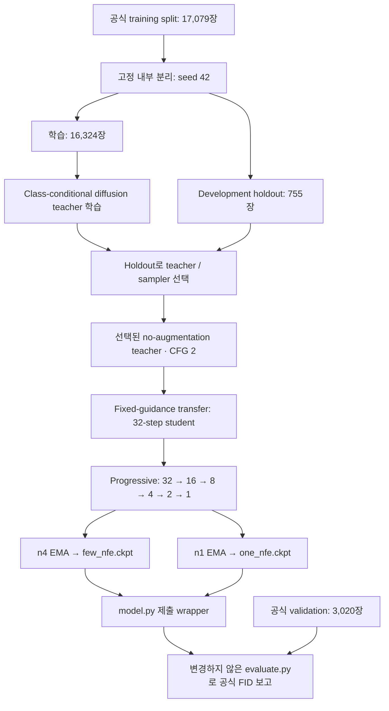

# Diffusion / FastGen 프로젝트 구조·현황·개선 방향

작성일: 2026-10-07  
기준: 현재 전달 폴더의 `TEAM_HANDOFF.md`와 `fastgen_code_overlay.zip` 내부 코드·설정·결과 문서. 최신 완료 실험 기록은 2026-09-30이다.

> 현재 프로젝트는 **class-conditional diffusion teacher의 CFG=2 생성 동작을 student에 전달하고, progressive distillation로 1/4 NFE까지 압축한 상태**다. Consistency distillation은 향후 방향이며 아직 구현되지 않았다. 2026-10-07 후속 작업에서 실행용 checkout·데이터·가상환경을 `workspace_distillation/`에 복원했다. 아래 실험 표는 과거 보고값이며, 이번 복원 검증과 공식 재평가 결과는 [축별 현황 및 실험 설명](DIFFUSION_STATUS_AND_EXPERIMENTS.md)에 별도로 기록한다.

## 1. 전체 아키텍처 구조

### 1.1 목표와 제약

151개 Pokémon 클래스에 대해 64×64 RGB 이미지를 생성하는 FastGen 프로젝트다. NFE는 이미지 생성 과정에서 수행하는 backbone 평가 횟수를 뜻한다.

| 항목 | 요구사항 / 현재 구현 |
| --- | --- |
| One-NFE 모델 | `ModelOneNFE`, backbone 정확히 1회 호출 |
| Few-NFE 모델 | 제한 ≤4회, 현재 `ModelFewNFE`는 정확히 4회 호출 |
| 모델 크기 | 프로젝트 기준 추론 모델당 <60M, 현재 각각 48,883,107 parameters |
| 학습 메모리 | 단일 GPU peak allocated VRAM <20GB |
| 데이터 | 제공 training split만 학습에 사용; 외부 이미지·pretrained 생성 모델 사용 금지 |
| 추론 | teacher 없이 student backbone 하나와 schedule buffer로 생성 |

### 1.2 학습부터 제출까지의 흐름



개발용 FID는 teacher·checkpoint 선택에 사용한다. 공식 validation은 설정이 고정된 뒤 결과를 보고하는 용도로만 사용한다. 두 FID는 reference 분포가 다르므로 서로 직접 비교하지 않는다.

### 1.3 공통 backbone: ClassConditionalUNet

Teacher와 student는 같은 pixel-space U-Net 구조를 사용한다. VAE나 latent encoder/decoder는 없다. 이미지와 클래스 ID는 각각 `[-1,1]` 범위의 `[B,3,64,64]` tensor, `0…150` 정수다.

| 구간 | 해상도 | 출력 채널 | 구성 |
| --- | --- | ---: | --- |
| Input convolution | 64×64 | 96 | 3×3 convolution |
| Encoder level 0 | 64×64 | 96 | Residual block 2개 |
| Encoder level 1 | 32×32 | 192 | Residual block 2개 |
| Encoder level 2 | 16×16 | 288 | Residual block 2개 + attention |
| Encoder level 3 | 8×8 | 384 | Residual block 2개 |
| Middle | 8×8 | 384 | Residual block 2개 + attention 1개 |
| Decoder | 8 → 16 → 32 → 64 | 384 → 288 → 192 → 96 | Level당 residual block 3개, encoder skip concatenate |
| Output | 64×64 | 3 | GroupNorm → SiLU → 3×3 convolution |

- Base channels 96, channel multipliers `(1,2,3,4)`, residual block 총 22개, single-head attention 총 6개다.
- Timestep의 sinusoidal embedding을 MLP로 384차원으로 바꾸고 class embedding을 더한다. 각 residual block은 이 condition으로 normalization의 scale/shift를 조절한다.
- 실제 클래스 151개에 null class ID `151`을 더해 embedding은 152개다. Student에서도 null embedding은 parameter count에 포함된다.
- 구조 정의는 `teacher/model.py`, 제출용 생성자는 `distillation/submission.py`에 있다.

### 1.4 Teacher: epsilon prediction과 CFG

Teacher는 1,000-step linear beta schedule (`1e-4 → 0.02`)을 사용한다. 학습에서는 실제 이미지에 Gaussian noise를 더한 뒤 epsilon MSE로 noise를 예측한다. 클래스 label을 확률 0.1로 null ID로 바꿔 unconditional prediction도 함께 학습한다.

```text
epsilon_cfg = epsilon_uncond + scale × (epsilon_cond - epsilon_uncond)
```

CFG 식은 `teacher/cfg.py`에 공통화되어 있다. Scale 0은 unconditional, 1은 conditional이며, CFG=2에서는 step당 conditional/unconditional forward를 각각 수행한다. 따라서 선택 teacher의 DDIM32 CFG2는 **32 steps / 64 NFE**다.

Teacher는 DDPM과 deterministic DDIM sampling을 지원한다. 선택된 teacher는 `teacher_b64_noaug_constant_100k`이며, batch 64, constant LR `2e-4`, warmup 없음, bf16, 100K updates, augmentation 없음으로 학습했다. Primary EMA는 0.9999이고 0.999도 함께 추적했다.

### 1.5 Student: fixed guidance와 progressive distillation

1. **Guidance transfer:** 선택된 teacher의 CFG=2 clean-image 예측을 32-step student의 단일 conditional forward에 전달한다. Teacher feature weight로 초기화하되 출력 의미가 epsilon에서 v로 바뀌므로 첫 student output head는 zero reset한다. 학습은 50K updates다.
2. **Progressive halving:** frozen 이전 stage의 두 DDIM transition을 다음 student의 한 transition으로 근사한다. `32 → 16 → 8 → 4 → 2 → 1` 순서로 학습하고, 다음 stage는 이전 EMA weight에서 초기화한다. 최초 baseline은 각 halving stage 25K updates다.
3. **추가 budget 실험:** n1과 n2를 각각 기존 25K full checkpoint에서 100K까지 이어 학습했다. n1은 기존 25K n2를, n2는 기존 n4를 teacher로 고정했다. 개선된 n2로 새 n1을 학습한 실험은 아니다.

Student는 v-prediction을 사용하고 clean prediction은 `x0 = a·x_t - sigma·v`로 계산한다. Loss는 truncated-SNR clean-image loss와 동등한 `max(a², sigma²)·MSE(v_pred, v_target)`이다. Batch 64, constant LR `2e-4`, warmup 없음, EMA 0.999, bf16을 사용한다.

Progressive effective target과 중간 student clean prediction은 clip하지 않고 최종 RGB만 `[-1,1]`로 clip한다. 중간 clipping은 두 step을 한 step으로 합치는 endpoint 식을 바꿀 수 있기 때문이다. Student에서는 class dropout이나 추론 시 CFG 두 번 호출을 사용하지 않는다.

### 1.6 추론·평가 계층

```text
evaluate.py
  → Model.load_checkpoint(path, one_nfe / few_nfe)
  → ModelOneNFE / ModelFewNFE
  → distillation.submission.submission_sample()
  → distillation.core.sample_velocity()
  → ClassConditionalUNet 1회 / 4회
  → RGB tensor [B,3,64,64], [-1,1]
```

`Model` base class의 checkpoint loading·parameter counting interface는 보존하고 두 subclass만 구현했다. Export는 학습 checkpoint의 EMA를 추론용 `state_dict`로 변환한다. 추론 checkpoint에는 schedule·sampling seed buffer와 provenance가 포함되지만 optimizer·EMA 학습 상태·RNG resume 상태는 없다.

## 2. 현황

### 2.1 최신 성능

FID는 낮을수록 좋다. 아래는 완료 문서에 기록된 결과이며, development는 755개 training-only reference, official은 3,020개 validation reference를 사용한다.

| 모델 / 실험 | 학습 budget | NFE | Development FID | Official FID | 전달 여부 |
| --- | --- | ---: | ---: | ---: | --- |
| 선택 noaug teacher, DDIM32 CFG2 | Teacher 100K | 64 | 44.11891 | 26.65365 | Teacher weight 별도 전달 필요 |
| Fixed guidance student | 50K | 32 | 43.25620 | — | 학습 weight 별도 필요 |
| Progressive n4 | 해당 stage 25K | 4 | 47.62077 | **33.0517** | `few_nfe.ckpt` 포함 |
| 기존 progressive n1 | 해당 stage 25K | 1 | 68.16127 | 61.4540 | 과거 baseline 기록 |
| Budget extension n1 | 누적 100K | 1 | **65.38627** | **58.1595** | 개선된 `one_nfe.ckpt` 포함 |
| Budget extension n2 | 누적 75K 선택, 100K까지 완료 | 2 | **50.89945** | **39.54904** | 기본 inference ZIP에는 없음 |

현재 ZIP의 `one_nfe.ckpt`는 100K 모델이다. Handoff가 설명하는 **기존 원 작업 폴더**의 같은 이름 checkpoint는 25K 모델이므로, 경로 이름만으로 버전을 판단하면 안 된다. `few_nfe.ckpt`는 기존 n4 모델이다.

### 2.2 완료된 것과 남은 것

| 영역 | 상태 |
| --- | --- |
| Teacher 학습, CFG, DDPM/DDIM, EMA, checkpoint/resume | 구현·실험 완료 |
| Training-only holdout, teacher 선택 | 고정 manifest 및 선택 정책 구현 |
| Fixed-CFG transfer + progressive distillation | 전체 stage 완료 |
| 1/4-NFE wrapper, export, 공식 FID | 완료·결과 보고 |
| n1/n2 25K → 100K budget 비교 | 완료; n1 100K, n2 75K가 development 기준 선택됨 |
| Consistency distillation | **미구현** |
| Variable-guidance student, guidance curriculum, LoRA | 현재 baseline에 포함되지 않음 |
| 현재 로컬 실행 환경·데이터 | `workspace_distillation/`에 복원 및 GPU smoke 검증 완료 |
| Full training checkpoint | 전달 파일에 없음; 정확한 continuation에는 추가 전달 필요 |

기존 smoke 기록에서는 두 제출 모델의 parameter count 48,883,107, 실제 backbone call count 1/4회, deterministic sampling, export/load, endpoint inversion을 확인했다. Budget 실험의 peak allocated VRAM은 9,796,747,776 bytes로 20GB 제한 이하다. 이 검증은 과거 실행 기록이며 현재 환경에서 새로 측정한 값은 아니다.

### 2.3 성능 해석과 운영상 주의점

- 가장 큰 압축 손실은 기존 n2 → n1 구간이다. Development FID가 51.69442에서 68.16127로 16.46685 증가했다. 1-NFE 이미지의 경계·작은 특징이 더 흐리다는 관찰은 있으나, diversity collapse를 입증한 것은 아니다.
- n1을 100K까지 학습하면 official FID가 61.4540 → 58.1595로 3.2945 개선된다. 학습 budget만 늘려도 도움이 되었지만 4-NFE 33.0517과의 격차는 여전히 크다.
- README reference score 39.15 / 30.90 대비 현재 1/4-NFE 차이는 각각 +19.0095 / +2.1517이다. Reference score는 이 프로젝트의 결과가 아니다.
- n2의 75K → 100K development 차이는 약 0.047이다. 단일 seed 결과만으로 overfitting이라고 단정할 수 없다.
- Low-NFE 실행 wrapper에 종료 코드 127이 기록되었지만, 문서에 따르면 학습·평가·summary 작성 후 shell 오류가 발생했고 별도 완료 checkpoint/metric audit는 통과했다. 향후에는 학습 완료와 wrapper 종료를 함께 확인해야 한다.
- 과거 문서에는 “teacher만 구현”, “stage 학습 중” 등의 당시 상태가 남아 있다. 최신 현황은 `TEAM_HANDOFF.md`와 `docs/low_nfe_budget_experiment.md`의 완료 결과를 우선한다.

## 3. 개선 방향성

아래는 현 결과를 바탕으로 한 제안이며, 새 실험을 실행했다는 뜻은 아니다. 이미 완료된 100K budget 실험을 다음 할 일로 반복하지 않는다.

| 우선순위 | 방향 | 구체적인 실행과 비교 기준 |
| --- | --- | --- |
| P0 | 재현 가능한 실행 환경 복원 | 정확한 upstream commit에 overlay 적용, 데이터 준비, checkpoint load·parameter·1/4-NFE 확인 후 동일 batch/seed로 official 결과 재현 |
| P1 | 개선된 n2로 새 n1 학습 | Development에서 선택된 n2 75K를 frozen teacher로 사용. 기존 25K n2를 teacher로 사용한 n1 100K와 student budget·split·LR·seed를 맞춰 비교 |
| P2 | 2 → 1 압축 실패 원인 진단 | 고정 class/seed의 teacher 두-step target과 student 한-step 결과를 비교. 클래스별 오류, 경계·고주파·포화, train/holdout 차이를 분석하고 필요시 의존성 정책 내 quality/coverage metric 추가 |
| P3 | Fixed-CFG consistency distillation baseline | 동일 teacher·split·추론 budget에서 독립 baseline 구현. Boundary condition, noise/time schedule, EMA target, consistency loss를 검증하고 progressive 1/4-NFE와 비교 |
| P4 | Schedule / 학습-추론 분포 차이 검증 | t=999의 작은 비영 신호와 pure-noise 입력의 불일치, nonterminal noisy-real 학습과 generated trajectory 추론 차이를 각각 별도 실험으로 검증 |
| P5 | Guidance 확장과 추가 ablation | Fixed-guidance consistency가 검증된 뒤 variable-guidance conditioning, guidance distribution/curriculum, Full FT vs LoRA 순서로 비교 |

P0 실행 환경 복원과 GPU smoke는 후속 작업에서 완료했다. 현재 약점이 명확한 1-NFE를 우선 개선하고 4-NFE baseline은 보존한다. Schedule 변경은 기존 teacher의 추론 schedule만 바꿔 결론 내리지 말고 학습·sampling을 일관되게 설계한 새 실험으로 수행한다. 구조·loss·guidance를 동시에 변경하면 개선 원인을 구분하기 어렵다.

새 학습의 기본 정책은 **constant LR, warmup 없음**이다. 공식 validation으로 teacher·guidance·checkpoint를 선택하지 않고 동일 training-only holdout을 사용한다. Sampling seed 반복은 sampling 변동성만 측정하므로, 핵심 결론은 추가 training seed로도 확인하는 것이 좋다.

운영 측면에서는 checkpoint마다 teacher provenance, stage, budget, split hash, EMA, sampling grid, parameter/NFE/VRAM을 명시하고, 실행 중 runner를 수정하지 않도록 한다. 오래된 문서의 진행 상태를 최종 결과로 갱신하면 팀원이 미완료 작업과 완료 실험을 혼동하는 문제를 줄일 수 있다.

## 4. 현재 디렉토리 구조 설명

### 4.1 실제 로컬 전달 폴더

```text
/root/Diffusion/
├── TEAM_HANDOFF.md                     # 팀 전달·복원 안내
├── SHA256SUMS.txt                      # 두 ZIP의 SHA-256
├── fastgen_code_overlay.zip            # 추가/수정 코드·설정·문서·holdout manifest
├── fastgen_inference_checkpoints.zip   # 1-NFE 100K + 4-NFE 추론 weight
├── DIFFUSION_PROJECT_OVERVIEW.md        # 본 문서
├── DIFFUSION_STATUS_AND_EXPERIMENTS.md  # 복원 검증·축별 현황·각 실험 설명
├── DIFFUSION_CONCEPTS.tex / .pdf        # 개념 설명 LaTeX 원본 및 PDF
└── workspace_distillation/             # 복원된 실행용 checkout·.venv·데이터·weight
```

압축을 푼 `teacher/`, `distillation/`, `checkpoints/`는 하위 `workspace_distillation/`에 있다. 두 ZIP의 checksum은 `sha256sum -c SHA256SUMS.txt`로 확인했고 모두 OK였다. 코드 ZIP은 독립 실행 가능한 전체 저장소가 아니라 upstream에 덮어 적용하는 overlay다.

### 4.2 Code overlay ZIP 내부

아래는 ZIP 안에 실제 포함된 경로의 기능별 요약이다. `...`는 같은 디렉토리의 추가 파일을 생략한 표기다.

```text
fastgen_code_overlay.zip
├── .gitignore
├── CODEX.md                         # 구현 규칙·constant LR 정책·작업 범위 기록
├── PROJECT_SPEC.md                  # 목표·연구 계획·제약
├── TEAM_HANDOFF.md                  # 전달 안내 사본
├── OVERLAY_MANIFEST.json            # Overlay manifest
├── model.py                        # 제출 interface; 두 subclass 구현
├── constraints/
│   └── evaluation.txt               # 평가 제약
├── configs/
│   ├── teacher/                     # Teacher 실험별 JSON
│   │   ├── teacher_b64_noaug_constant_100k.json
│   │   └── ...
│   └── distillation/
│       ├── fixed_cfg2_progressive.json
│       └── low_nfe_budget_100k.json
├── teacher/
│   ├── model.py                     # 공통 U-Net backbone
│   ├── diffusion.py                 # Noise schedule·epsilon loss·DDPM/DDIM
│   ├── cfg.py                       # 공통 CFG 계산
│   ├── config.py                    # 설정 로딩·검증
│   ├── data.py / splits.py          # Train adapter·내부 holdout
│   ├── train.py                     # 학습·EMA·checkpoint/resume
│   ├── sample.py / evaluate.py      # Teacher 생성·FID
│   ├── smoke.py                     # 실행 검증
│   └── utils.py / __init__.py
├── distillation/
│   ├── core.py                      # v prediction·DDIM·두-step target·loss
│   ├── train.py                     # Guidance/progressive student 학습
│   ├── pipeline.py                  # Teacher 선택·quality gate·stage 실행
│   ├── evaluate.py                  # Student 개발용/내부 평가
│   ├── export.py                    # EMA를 제출 checkpoint로 export
│   ├── submission.py                # 제출 backbone·buffer·sampling
│   └── smoke.py / __init__.py
├── scripts/                        # 실험 실행·진단·budget continuation·전달 도구
│   ├── run_teacher_to_students.sh
│   ├── run_fixed_guidance_distillation.sh
│   ├── run_low_nfe_budget.py
│   ├── run_low_nfe_budget.sh
│   ├── create_handoff.py
│   └── ...
├── data/development/seed42_holdout5/
│   ├── train.txt                    # 16,324개 학습 경로
│   ├── holdout.txt                  # 755개 내부 평가 경로
│   └── metadata.json                # Seed·클래스 수·원본 split hash
└── docs/                           # 구조 분석·실험별 실행 기록·결과 해석
    ├── model_architecture.md
    ├── repository_analysis.md
    ├── distillation_baseline.md
    ├── distillation_results_review.md
    ├── low_nfe_budget_experiment.md
    └── ...
```

Inference ZIP에는 다음 두 파일만 있다.

```text
checkpoints/
├── one_nfe.ckpt     # 개선된 100K n1, official FID 58.1595
└── few_nfe.ckpt     # 기존 n4, official FID 33.0517
```

### 4.3 Upstream에 적용한 뒤의 작업 디렉토리

아래는 **복원 작업 디렉토리 구조**다. 실제 이미지와 reference는 복원됐으며 공식 평가 출력은 `results/`에 생성한다. `experiments/`의 과거 full 학습 artifact는 여전히 미포함이므로 해당 가지는 별도 전달이 필요한 경로를 표시한다.

```text
workspace_distillation/
├── README.md / requirements.txt     # Upstream 환경·challenge 규칙
├── dataset.py                      # Upstream dataset, 수정 금지
├── download_dataset.py             # Upstream 데이터 준비, 수정 금지
├── evaluate.py                     # 공식 evaluator, 수정 금지
├── src/utils.py                    # Parameter accounting, 수정 금지
├── model.py                        # Base 보존, One/Few subclass 구현
├── teacher/ / distillation/         # Overlay 구현
├── configs/ / scripts/ / docs/      # Overlay 설정·실행 도구·문서
├── data/
│   ├── pokemon-generation-one-22k/  # 원본 split·class mapping + 복원된 이미지
│   └── development/seed42_holdout5/
│       ├── train.txt / holdout.txt / metadata.json
│       └── reference/              # Holdout 755 PNG, 이번 복원에서 생성
├── checkpoints/                    # Inference ZIP에서 복원
├── .venv/                          # 독립 Python 3.10 / torch 2.6.0+cu124 환경
├── environment/                    # Lock·복원 보고서·검증/평가 재현 도구
├── experiments/                    # 아래 과거 full checkpoint 경로는 미복원
│   ├── teacher_b64_noaug_constant_100k/
│   ├── fixed_cfg2_progressive/{guidance,n16,n8,n4,n2,n1}/
│   └── low_nfe_budget_100k/{n1,n2}/
└── results/                        # 공식 reference 및 이번 공식 재평가 산출물
```

`dataset.py`, `download_dataset.py`, `evaluate.py`, `src/utils.py`, 원본 train/val split은 overlay에 포함되지 않으며 수정하면 안 된다. `model.py`에서도 공통 `Model` base는 보존해야 한다.

### 4.4 복원·추가 학습에 필요한 파일

Overlay는 upstream `KAIST-Visual-AI-Group/AIC313-Project-FastGen`의 **commit `e3f5120000cd91037017d86f23993492195101a5`의 깨끗한 checkout**에 적용한다. 기존 작업 폴더에 바로 덮어쓰지 않는다. 환경은 원본 README를 따르고 데이터는 원본 downloader로 준비한다. 새 의존성은 추가하지 않았다.

추론에는 원본 저장소, overlay, inference ZIP, 환경이 필요하다. FID 재평가에는 실제 데이터와 reference 준비가 추가로 필요하다. 학습 재개에는 다음 full checkpoint를 별도 전달받아 원래 상대 경로를 보존해야 한다.

| 목적 | 필요한 추가 artifact |
| --- | --- |
| 선택 teacher에서 distillation 시작 | `experiments/teacher_b64_noaug_constant_100k/final.pt` |
| 기존 progressive n4/n2/n1 연장 | `experiments/fixed_cfg2_progressive/{n4,n2,n1}/final.pt` |
| 개선된 n1 재개 | `experiments/low_nfe_budget_100k/n1/final.pt` |
| 선택된 75K n2로 새 n1 학습 | `experiments/low_nfe_budget_100k/n2/step_075000.pt` |
| n2 100K 상태에서 재개 | `experiments/low_nfe_budget_100k/n2/final.pt` |

`reference/`의 755 PNG는 선택 teacher checkpoint와 원본 데이터가 준비되면 `teacher.evaluate --reference-split development` 경로로 다시 만들 수 있다. 추론용 `.ckpt`만으로 기존 optimizer·EMA·RNG를 보존한 정확한 continuation은 할 수 없다.

## 근거 문서

- 로컬 [TEAM_HANDOFF.md](TEAM_HANDOFF.md): 전달 파일, 정확한 base commit, 최신 checkpoint, 복원 절차.
- Code ZIP 내부 `docs/low_nfe_budget_experiment.md`: 100K 완료 결과, 선택 n1/n2, resume 검증과 실행 오류 해석.
- Code ZIP 내부 `docs/distillation_results_review.md`: 최초 stage별 FID, 1-NFE 진단, 학습/추론 제약 검증 기록.
- Code ZIP 내부 `docs/distillation_baseline.md`: fixed-guidance/progressive 알고리즘과 초기화·loss·export 정책.
- Code ZIP 내부 `docs/model_architecture.md`, `teacher/model.py`, `distillation/core.py`, `distillation/submission.py`: backbone과 실제 sampling 구현. Architecture 문서의 과거 LR·구현 상태는 최신 config/완료 기록으로 보완했다.
- Code ZIP 내부 `docs/repository_analysis.md`, `configs/teacher/teacher_b64_noaug_constant_100k.json`, `configs/distillation/*.json`, `data/development/seed42_holdout5/metadata.json`: 원본 interface, 선택 실험 설정, 데이터 분리.
