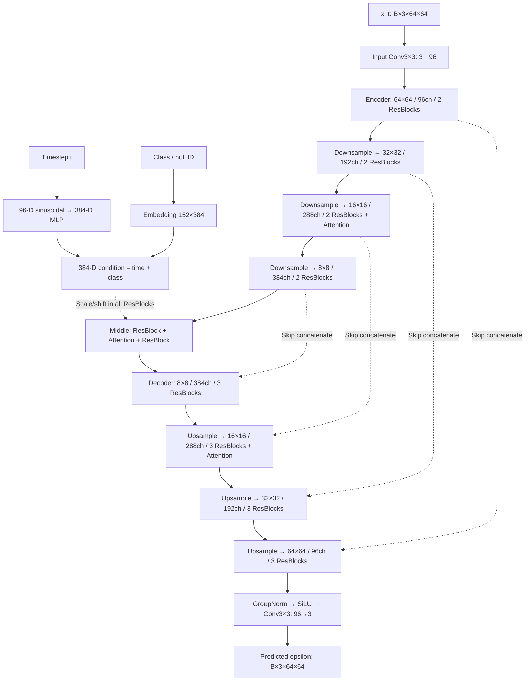

# Teacher model 상세 구조와 개선 실험 설계

작성일: 2026-10-07. 기준 모델은 `teacher_b64_noaug_constant_100k`다. 복원된 코드·설정을 직접 읽고 random-init 모델의 CPU forward hook으로 tensor shape와 parameter count를 재확인했다. 과거 FID·학습시간은 완료 문서의 보고값이다.

> 현재 teacher는 **64×64 RGB pixel-space class-conditional U-Net, epsilon prediction, 48,883,107 parameters**다. No-augmentation으로 100K updates 학습한 teacher가 CFG2 distillation의 출발점으로 선택됐다. 다음 비교는 **동일 noaug teacher의 budget 확대**와 **동일 budget에서 augmentation만 변경**을 분리하는 것이 해석하기 쉽다. 본 요청에서는 구조와 실험 설계를 문서화했으며 추가 학습을 시작하지 않았다.

## 1. Teacher의 역할과 현재 상태

Teacher는 noisy image, timestep, class를 입력받아 noise를 예측한다. Sampling에서는 여러 번 반복 호출해 이미지를 생성하고, distillation에서는 student가 모방할 prediction 또는 trajectory를 제공한다.

Teacher와 student는 동일한 U-Net 구조를 사용하지만 출력 의미와 학습 목표가 다르다.

| 구분 | Teacher | 현재 student |
| --- | --- | --- |
| 출력 의미 | Noise `epsilon` | Velocity `v` |
| 학습 target | 실제 이미지에 주입한 Gaussian noise | Teacher의 guided prediction / merged transition target |
| Class dropout | 0.1 | 사용하지 않음 |
| CFG | 필요 시 conditional/unconditional을 각각 평가 | Fixed CFG2 동작을 weight에 흡수 |
| 생성 계산 | DDIM32 CFG2에서 64 NFE | 제출 모델은 1 / 4 NFE |
| Parameters | 48,883,107 | 각 모델 48,883,107 |

현재 선택 teacher의 full checkpoint는 전달 ZIP에 없다. 코드·데이터·환경은 복원되어 fresh training은 가능하지만, **기존 teacher의 100K 상태에서 이어 학습하려면** `workspace_distillation/experiments/teacher_b64_noaug_constant_100k/final.pt`가 추가로 필요하다. `checkpoints/one_nfe.ckpt`나 `few_nfe.ckpt`는 student weight이므로 teacher checkpoint를 대신할 수 없다.

## 2. 모델 입출력과 주요 설정

| 항목 | 값 |
| --- | --- |
| 구현 class | `teacher.model.ClassConditionalUNet` |
| 입력 `x_t` | `[B,3,64,64]`, noisy RGB |
| 입력 `t` | `[B]`, integer diffusion index `0…999` |
| 입력 `labels` | `[B]`, 실제 class `0…150`, null class `151` |
| 출력 | `[B,3,64,64]`, predicted epsilon |
| 실제 이미지 normalization | `[-1,1]` |
| 기본 채널 | 96 |
| Channel multipliers | `(1,2,3,4)` |
| Time/class condition | 384 dimensions |
| Encoder residual blocks | Level당 2개, 총 8개 |
| Middle residual blocks | 2개 |
| Decoder residual blocks | Level당 3개, 총 12개 |
| Self-attention | 총 6개, single head |
| Downsample / upsample | 각 3개 |
| Network dropout | 0.0 |
| Activation checkpointing | 지원하지만 선택 run에서는 비활성화 |

Teacher의 noisy input과 epsilon output은 일반적으로 `[-1,1]` 범위가 아니다. `[-1,1]`은 clean image normalization과 최종 RGB 출력 범위다. Output head에 sigmoid/tanh를 사용하지 않는다.

## 3. 전체 U-Net 구조



그림은 해상도별 요약이다. 실제 코드에서는 input convolution 출력과 encoder의 **각 block/downsample 출력**을 모두 저장하고 decoder의 residual block마다 하나씩 꺼낸다. 총 12개 skip tensor가 12개 decoder blocks에 연결된다. Condition은 middle뿐 아니라 전체 22개 residual blocks에 적용한다.

### 3.1 Encoder와 middle: 실제 channel 변화

Shape는 batch 축을 제외한 `C×H×W`이며 아래 값은 CPU forward hook으로 확인했다.

| 코드 module | 입력 shape | 출력 shape | 연산 |
| --- | --- | --- | --- |
| `input_conv` | 3×64×64 | 96×64×64 | Conv3×3 |
| `down.0`, `down.1` | 96×64×64 | 96×64×64 | Residual block 각 1개 |
| `down.2` | 96×64×64 | 96×32×32 | Stride-2 Conv3×3 |
| `down.3` | 96×32×32 | 192×32×32 | Residual block |
| `down.4` | 192×32×32 | 192×32×32 | Residual block |
| `down.5` | 192×32×32 | 192×16×16 | Stride-2 Conv3×3 |
| `down.6` | 192×16×16 | 288×16×16 | Residual + attention |
| `down.7` | 288×16×16 | 288×16×16 | Residual + attention |
| `down.8` | 288×16×16 | 288×8×8 | Stride-2 Conv3×3 |
| `down.9` | 288×8×8 | 384×8×8 | Residual block |
| `down.10` | 384×8×8 | 384×8×8 | Residual block |
| `middle1` | 384×8×8 | 384×8×8 | Residual + attention |
| `middle2` | 384×8×8 | 384×8×8 | Residual block |

### 3.2 Decoder와 skip concatenate

Decoder의 입력 channel이 큰 이유는 decoder feature와 encoder skip을 channel 축으로 이어 붙이기 때문이다.

| 코드 module | 입력 channel 구성 | 출력 shape | Attention |
| --- | --- | --- | --- |
| `up.0` | 384 + 384 = 768 | 384×8×8 | 없음 |
| `up.1` | 384 + 384 = 768 | 384×8×8 | 없음 |
| `up.2` | 384 + 288 = 672 | 384×8×8 | 없음 |
| `up.3` | 384 | 384×16×16 | Upsample |
| `up.4` | 384 + 288 = 672 | 288×16×16 | 있음 |
| `up.5` | 288 + 288 = 576 | 288×16×16 | 있음 |
| `up.6` | 288 + 192 = 480 | 288×16×16 | 있음 |
| `up.7` | 288 | 288×32×32 | Upsample |
| `up.8` | 288 + 192 = 480 | 192×32×32 | 없음 |
| `up.9` | 192 + 192 = 384 | 192×32×32 | 없음 |
| `up.10` | 192 + 96 = 288 | 192×32×32 | 없음 |
| `up.11` | 192 | 192×64×64 | Upsample |
| `up.12` | 192 + 96 = 288 | 96×64×64 | 없음 |
| `up.13` | 96 + 96 = 192 | 96×64×64 | 없음 |
| `up.14` | 96 + 96 = 192 | 96×64×64 | 없음 |
| `out_norm → SiLU → out_conv` | 96 | 3×64×64 | 없음 |

Upsample은 nearest-neighbor 2배 확대 후 Conv3×3이다. 각 decoder residual block의 shortcut에서도 입력 channel과 출력 channel이 다르면 Conv1×1을 사용한다.

### 3.3 Parameter 구성

| Module group | Parameters | 역할 |
| --- | ---: | --- |
| `time_mlp` | 185,088 | Timestep condition |
| `class_emb` | 58,368 | 실제 151 classes + null token |
| `input_conv` | 2,688 | RGB feature 추출 |
| `down` | 12,710,112 | Encoder + downsample |
| `middle1` | 3,544,320 | Middle residual + attention |
| `middle2` | 2,952,192 | Middle residual |
| `up` | 29,427,552 | Decoder + upsample |
| `out_norm` | 192 | 최종 normalization |
| `out_conv` | 2,595 | Epsilon 출력 |
| **합계** | **48,883,107** | Null embedding 포함 |

Decoder가 전체 parameter의 약 60.2%를 차지한다. Skip concatenate로 residual block 입력 channel이 커지기 때문이다. Teacher architecture를 바꾸면 현재 고정 architecture의 student constructor/export도 함께 점검해야 하므로, budget/augmentation 실험에서는 우선 구조를 고정한다.

## 4. Block 내부 구조

### 4.1 Residual block

```text
입력 x
 ├─ GroupNorm → SiLU → Conv3×3
 │  → GroupNorm
 │  → condition 기반 scale/shift
 │  → SiLU → Dropout(p=0) → Conv3×3
 └─ Identity 또는 Conv1×1 shortcut
           ↓
       두 경로를 더함
```

Condition 변환은 `Linear(SiLU(emb))`, 출력은 `2×out_channels`다. 이를 둘로 나눠 scale과 shift를 만든다.

```text
scale, shift = Linear(SiLU(emb)).chunk(2)
h = GroupNorm(h) * (1 + scale) + shift
```

GroupNorm의 group 수는 `gcd(channels,32)`이며 현재 사용되는 주요 channel 수에서는 32다. Normalization의 learned affine과 condition scale/shift가 함께 존재한다. Network dropout 0과 class dropout 0.1은 다른 설정이다.

### 4.2 Attention block

```text
x[B,C,H,W]
  → GroupNorm
  → [B,C,H*W]로 reshape
  → Conv1d(1×1)로 Q,K,V 생성
  → softmax(QᵀK / sqrt(C))
  → V와 attention weight 결합
  → output projection
  → 입력 x와 residual addition
```

Single-head spatial self-attention이다. 16×16에서는 256개 위치, middle 8×8에서는 64개 위치를 비교한다. 64×64에서는 attention을 사용하지 않는다.

Q/K/V의 attention 산술 코드에는 `.float()`가 있지만, CUDA autocast 안의 `bmm`까지 항상 FP32로 실행된다고 보장하지는 않는다. 엄밀한 precision 비교 실험을 하려면 실제 연산 dtype을 측정하고 autocast 범위를 검토한다. 이것은 개선 후보이며 현재 품질 저하의 확인된 원인은 아니다.

### 4.3 초기화와 activation checkpointing

- Attention output projection과 최종 epsilon output convolution은 zero initialization이다.
- Residual block의 두 번째 convolution은 PyTorch 기본 초기화다.
- Activation checkpointing은 설정된 해상도에서 training forward의 일부 activation을 backward 때 재계산해 메모리를 줄이는 기능이다. 선택 run의 `activation_checkpoint_resolutions=[]`에서는 사용하지 않는다.
- Budget만 늘리면 구조·batch가 같아 peak VRAM이 step 수에 비례해 늘지는 않는다. 대신 학습시간, 저장공간, checkpoint I/O가 증가한다.

## 5. Time/class conditioning

```text
timestep t[B]
  → 96-D sinusoidal embedding
  → Linear(96,384) → SiLU → Linear(384,384)

class ID 또는 null ID[B]
  → Embedding(152,384)

emb[B,384] = time_embedding + class_embedding
  → 모든 residual blocks의 scale/shift layer
```

Sinusoidal frequencies는 `exp(-log(10000)*i/(half-1))`, `half=48`로 생성하고 cosine/sine을 concatenate한다. Class embedding은 random initialization에서 학습하며 pretrained semantic embedding을 사용하지 않는다.

Teacher에는 **guidance-scale embedding이나 augmentation-parameter embedding이 없다.** 따라서 affine augmentation을 적용해도 network가 회전·이동량을 별도 condition으로 받지 않는다. 현재 모델이 학습하는 이미지 분포가 transformed image를 포함하도록 바뀐다.

## 6. Diffusion 학습 objective와 CFG

### 6.1 Forward noise와 loss

```text
beta_t = linear(0.0001, 0.02), 1,000 timesteps
alpha_t = 1 - beta_t
alpha_bar_t = cumulative_product(alpha_t)

t ~ Uniform({0,...,999})
epsilon ~ Normal(0,I)
x_t = sqrt(alpha_bar_t) * x_0 + sqrt(1-alpha_bar_t) * epsilon

loss = mean((model(x_t,t,c') - epsilon)^2)
```

Beta/cumulative product는 내부에서 float64로 만든 후 `alpha_bar`를 float32로 저장한다. Epsilon MSE는 prediction과 noise를 FP32로 변환해 계산한다. Learned variance, VLB auxiliary loss, teacher의 v prediction은 현재 구현하지 않았다.

Class dropout으로 각 label을 확률 0.1로 null ID 151로 바꿔 `c'`를 만든다. 일반 학습 step에서는 noisy image당 **한 branch만** forward한다. Training loss를 계산하면서 매번 CFG의 두 forward를 수행하는 방식은 아니다.

### 6.2 Sampling CFG

```text
epsilon_uncond = model(x_t,t,null_id)
epsilon_cond   = model(x_t,t,class_id)
epsilon_cfg    = epsilon_uncond + g*(epsilon_cond-epsilon_uncond)
```

`g=0`은 unconditional, `g=1`은 ordinary conditional, `g=2`는 선택된 distillation guidance다. `g=2` sampling은 step마다 두 forward가 필요하다.

**Config의 `guidance_scale=1.0`, `sample_steps=50`은 학습 중 preview sampling 설정이다.** Teacher의 loss를 CFG1로 고정 학습하거나 50-step diffusion으로 학습한다는 뜻이 아니다. 실제 학습 noise schedule은 1,000 timesteps다. 선택된 teacher의 distillation 비교는 별도 CLI로 DDIM32 CFG2를 사용한다.

### 6.3 Sampling과 clipping

Teacher는 DDPM과 deterministic DDIM을 지원한다. 선택 teacher의 자동 preview는 clipped DDPM50 CFG1이고, 선택·보고·distillation에는 clipped DDIM CFG2를 별도 사용했다.

| 용도 | Sampler / steps / guidance | NFE |
| --- | --- | ---: |
| 선택 run의 자동 preview | DDPM / 50 / CFG1 | 50 |
| Teacher 선택 기준 | DDIM / 50 / CFG2 | 100 |
| Distillation 시작 grid | DDIM / 32 / CFG2 | 64 |

Teacher의 intermediate clean estimate는 `[-1,1]`로 clip하는 설정을 사용한다. Student progressive의 merged target clipping 정책은 다르므로 그대로 복사하면 안 된다.

## 7. 데이터 파이프라인과 augmentation 위치

```text
고정 train manifest
  → 원본 RGB image 로딩
  → Resize(64,64)
  → RandomHorizontalFlip(p)                  # 설정 시
  → RandomAffine(rotation,translation,scale) # 설정 시
  → ToTensor
  → Normalize(mean=0.5,std=0.5)
  → Class dropout
  → Gaussian noise 주입
  → Epsilon MSE
```

| 데이터 | 개수 | 사용 |
| --- | ---: | --- |
| 공식 training split | 17,079 | 내부 분리의 원본 |
| Optimizer training subset | 16,324 | Gradient update |
| Training-only holdout | 755 | Class당 5장, teacher/config/checkpoint 선택 |
| 공식 validation | 3,020 | 고정 설정의 공식 결과 보고 |

증강은 **noise를 더하기 전에 clean training image에 적용**한다. Holdout/reference는 증강하지 않은 protected transform을 사용한다. 원본 downloader의 white-background compositing을 보존한다.

현재 `TrainImages`에서 지원하는 증강은 horizontal flip과 affine뿐이다.

| 설정 key | 의미 | 현재 noaug | 과거 affine+flip |
| --- | --- | ---: | ---: |
| `horizontal_flip_probability` | 좌우 반전 확률 | 0 | 0.5 |
| `augmentation_degrees` | Rotation 범위 ±degrees | 0 | 5 |
| `augmentation_translate` | 폭·높이 대비 translation 비율 | 0 | 0.02 |
| `augmentation_scale_delta` | Scale 범위 `1±delta` | 0 | 0.02 |

Affine는 bilinear interpolation과 RGB white fill `(255,255,255)`를 사용한다. 이미 64×64로 줄인 이미지에 다시 interpolation하므로 작은 윤곽선이 변할 수 있다. 이는 증강이 항상 나쁘다는 결론이 아니라 결과를 확인할 이유다.

Color jitter, random crop, cutout, MixUp, CutMix, augmentation conditioning은 현재 config만 바꿔 활성화할 수 없다. 별도 구현과 비교가 필요하다. `cache_training_images=True`는 augmentation이 켜진 상태에서는 현재 코드가 거부한다. Noaug에서는 사용할 수 있으나 전체 이미지 tensor의 CPU RAM 비용도 확인해야 한다.

## 8. 현재 training recipe와 budget 해석

| 설정 | 값 |
| --- | --- |
| Optimizer | AdamW, betas `(0.9,0.999)`, epsilon `1e-8` |
| Weight decay | 0 |
| Learning rate | `2e-4` constant |
| Warmup / LR decay | 없음 / 없음 |
| Batch / accumulation | 64 / 1 |
| Total updates | 100,000 |
| AMP | bf16; bf16에서는 GradScaler 비활성화 |
| Gradient clipping | Global norm 1.0 |
| Primary / secondary EMA | 0.9999 / 0.999 |
| Training seed | 42 |
| Preview / diagnostics interval | 1,000 / 5,000 updates |
| Save interval | 500 updates; `latest.pt`, 종료 시 `final.pt` |
| Train manifest | `data/development/seed42_holdout5/train.txt` |

Loader는 epoch마다 `seed+epoch`로 shuffle하며 **`drop_last=False`**다. 16,324장과 batch 64이면 epoch당 256 batches이며 마지막 batch는 4장이다. 따라서 실제 exposure 수는 `updates×64`보다 조금 작다.

| Total updates | 실제 exposure 계산값¹ | 학습 subset 기준 약 epochs | 100K 이후 추가 updates |
| --- | ---: | ---: | ---: |
| 100K | 6,376,600 | 390.63 | — |
| 150K | 9,564,900 | 585.94 | 50K |
| 200K | 12,753,140 | 781.25 | 100K |
| 300K | 19,129,740 | 1,171.88 | 200K |

¹ Fresh start, batch 64, accumulation 1, 동일 dataset 크기·epoch loader, 성공한 updates를 가정한 계산이다. 실제 `images_seen` 로그를 최종 기준으로 삼는다. Epoch 수는 이미지 exposure를 dataset 크기로 나눈 값이다.

과거 선택 noaug 100K의 학습시간은 **16,613.09초, 약 4시간 37분**, peak allocated VRAM은 **9,777,302,016 bytes, 약 9.78GB / 9.11GiB**였다. 동일 처리량이면 100K→200K 추가 비용은 대략 또 4시간 37분이지만, 현재 환경의 실제 throughput과 진단·저장·평가 비용을 다시 측정해야 한다. 이 시간은 보장치가 아니다.

EMA 0.9999의 대략적인 시간 규모는 10K updates, EMA 0.999는 1K updates다. Budget 비교에서는 우선 둘을 그대로 유지한다. Batch까지 바꾸면 exposure당 EMA smoothing과 update 수가 함께 달라져 단순 budget 비교가 되지 않는다.

## 9. 이미 수행한 augmentation 비교와 해석

아래는 같은 training-only holdout의 primary EMA, clipped DDIM50 CFG2 결과다. Architecture, B64, constant LR, 100K budget을 유지한 과거 비교다.

| Training augmentation | Development FID | 변화 |
| --- | ---: | --- |
| Affine + horizontal flip | 48.40064 | 과거 기준 |
| Horizontal flip만, p=0.5 | 44.36898 | Affine 제거 후 개선 |
| No augmentation | **43.57209** | Flip 제거 후 추가 개선 약 0.797 |

다만 DDIM50 **CFG1**에서는 flip-only **55.05821**, noaug **62.97505**로 noaug가 더 나빴다. 따라서 “증강을 없애면 항상 teacher가 좋아진다”는 결론은 성립하지 않는다. 목표인 CFG2 distillation에 맞는 평가 조건에서 선택한 결과다.

선택 noaug teacher의 **DDIM32 CFG2**는 development FID **44.11891**, official FID **26.65365**다. 이 점수와 위 DDIM50 점수는 sampling steps가 다르다. Official validation으로 augmentation이나 checkpoint를 다시 선택하면 안 된다.

또한 flip-only teacher의 sampling seed 비교에서 DDIM50→100의 mean holdout 개선은 약 0.028로 작았다. 이것은 **sampling steps를 늘리는 것**의 실험이며 **training updates를 늘리는 것**의 결과가 아니다. Noaug teacher의 100K 초과 budget 효과는 아직 보고되지 않았다.

## 10. 개선 실험 A: training budget 확대

### 10.1 확인하려는 가설

“현재 noaug teacher는 100K에서 아직 충분히 학습되지 않았고, 동일 recipe로 더 학습하면 holdout 생성 품질과 distillation target이 좋아지는가?”를 확인한다. Training loss 하락만으로 성공을 판단하지 않는다.

**제안:** noaug 100K→150K→200K를 먼저 비교하고, 명확한 개선 추세가 있을 때 300K를 검토한다. 300K부터 시작하면 200K 추가 비용을 먼저 지불하므로 중간 결과의 가치가 떨어진다. 이것은 프로젝트 이력에 근거한 실험 제안이며 개선을 보장하지 않는다.

### 10.2 비교에서 고정할 것

- 같은 teacher full state에서 continuation: raw weight, optimizer, primary/secondary EMA, RNG, epoch, batch cursor.
- Data manifest, class mapping, noaug, architecture, epsilon loss, linear diffusion schedule.
- Batch 64, accumulation 1, LR 2e-4 constant, warmup 0, EMA decays, training seed.
- 평가에서 DDIM32 CFG2와 DDIM50 CFG2, clipping, primary EMA, batch 16, sample count 3,020, holdout reference 755.

바꿀 것은 **`num_train_steps`와 새 experiment/output bookkeeping**이다. Original 100K checkpoint와 reports는 보존한다.

### 10.3 평가·checkpoint 계획

| 지점 | 실행 | 판단 |
| --- | --- | --- |
| 100K | Original checkpoint를 같은 개발 evaluator로 평가 | Baseline 재확인 |
| 150K | Primary EMA DDIM32/50 CFG2 holdout FID | Budget 효과와 sampler 영향 분리 |
| 200K | 같은 조건으로 평가 | 150K 대비 추가 개선 여부 |
| 필요 시 300K | 200K checkpoint에서 continuation | 비용 대비 개선이 있을 때만 확장 |

Primary teacher metric은 downstream grid와 맞춘 **DDIM32 CFG2 development FID**, secondary는 DDIM50 CFG2다. 기존 선택 기준은 DDIM50였으므로, 이번 실험에서 primary를 32로 삼는 변경은 **시작 전에 선언**하고 원래 50-step 결과도 함께 남긴다.

각 지점은 별도 고정 checkpoint 파일로 보존한다. 현재 teacher trainer는 `latest.pt`를 덮어쓰고 `final.pt`는 설정 budget 종료 시에만 만든다. **한 번에 200K로 실행하면 150K artifact가 자동 보존되지 않는다.** 150K에서 한 번 종료하고 200K를 새 run으로 이어 학습하거나, immutable milestone saving을 별도로 구현해야 한다. 본 문서는 후자를 이미 구현했다고 주장하지 않는다.

Sampling 반복은 batch별 seed가 `base_seed+batch_index`이므로 `42/1042/2042`처럼 seed 범위가 겹치지 않게 한다. 핵심 결론의 training-seed repeat는 별도 fresh run이며 sampling 반복과 다르다.

### 10.4 Config 변경 예시와 실행 조건

아래는 **향후 새 config에서 바꿀 field 예시**다. 기존 JSON을 덮어쓰지 않고 나머지 설정을 동일하게 유지한다.

```json
{
  "experiment_name": "teacher_b64_noaug_constant_150k",
  "num_train_steps": 150000,
  "learning_rate_schedule": "constant",
  "learning_rate": 0.0002,
  "warmup_steps": 0
}
```

이 fragment만으로 trainer를 실행할 수는 없다. 현재 noaug JSON 전체를 복사해 해당 field만 바꿔야 한다. Full 100K teacher checkpoint를 받은 뒤의 command 예시는 다음과 같다.

```bash
cd /root/Diffusion/workspace_distillation
source .venv/bin/activate

python -m teacher.train \
  --config configs/teacher/teacher_b64_noaug_constant_150k.json \
  --resume experiments/teacher_b64_noaug_constant_100k/final.pt
```

`--resume`가 없으면 fresh initialization이며 “선택 teacher 100K에서 continuation”이라고 부르면 안 된다. 현재는 예시 config 파일과 full checkpoint를 추가해야 위 command가 실행 가능하다.

## 11. 개선 실험 B: data augmentation

### 11.1 Budget과 독립적으로 비교

우선 동일 100K budget에서 augmentation만 바꾸는 비교를 하면 과거 noaug/flip/affine 결과와 연결하기 쉽다. 긴 budget을 새 기준으로 사용하고 싶다면 모든 augmentation arms를 동일 200K까지 학습하고 **noaug 200K**도 반드시 포함한다.

**Noaug 100K와 augmented 200K를 비교하면 budget과 augmentation이 동시에 달라진다.** 그 결과를 augmentation의 효과로 해석할 수 없다.

### 11.2 첫 비교 후보

| 실험 arm | Flip 확률 | Rotation | Translation | Scale delta | 의미 |
| --- | ---: | ---: | ---: | ---: | --- |
| A0 baseline | 0 | 0 | 0 | 0 | 같은 budget의 noaug |
| A1 weak flip | 0.25 | 0 | 0 | 0 | 기존 0/0.5 사이의 flip 강도 탐색 |
| A2 historical flip-only | 0.5 | 0 | 0 | 0 | 과거 flip-only 재확인 또는 추가 seed |
| A3 optional weak rotation | 0 | ±2° | 0 | 0 | Affine 재도입 시 한 요소만 먼저 비교 |

A1/A3의 수치는 작은 탐색 후보이며 논문으로 입증된 optimal 값이 아니다. 먼저 A0/A1을 비교하고, geometric augmentation이 필요하다는 진단이 있을 때 A3를 검토한다. 과거 affine+flip보다 강한 조합을 바로 넣을 근거는 현재 기록에 없다.

같은 initialization seed와 split을 사용하되, random augmentation이 추가되면 RNG 소비와 subsequent noise draw도 달라질 수 있다. “모든 실제 noise target까지 완전히 paired된 ablation”이라고 주장하려면 data augmentation RNG와 diffusion RNG를 분리하거나 실제 draw를 검사해야 한다. 먼저 동일 recipe/seed의 통제 비교로 기록한다.

### 11.3 Fresh run과 continuation의 질문은 다르다

| 방법 | 확인하는 질문 |
| --- | --- |
| Fresh noaug / augmented 모델을 같은 100K budget으로 학습 | 처음부터 augmentation을 쓰는 recipe의 효과 |
| 같은 noaug 100K에서 두 branch를 동일 50K 연장: noaug / augmentation on | 기존 teacher에 augmentation을 뒤늦게 추가하는 효과 |

두 번째 방법은 초기 100K가 공유되어 상대 비용이 작지만 “전체 training augmentation ablation”은 아니다. Augmentation on branch는 목적 이미지 분포가 바뀌는 fine-tuning 실험으로 구분한다. 기존 EMA·optimizer를 유지할지 reset할지도 비교 전에 정해야 하며, 같은 실험에서 augmentation 외에 reset 정책까지 바꾸지 않는다.

### 11.4 결과에서 함께 볼 것

- **생성 품질:** 동일 holdout FID, class palette/shape, 경계와 작은 특징, saturation.
- **Coverage/반복:** 여러 class의 고정 sample-index grids, 반복 pose/배경, nearest training neighbors. Pixel variance 하나로 semantic diversity를 결론 내리지 않는다.
- **Generalization:** 증강하지 않은 train/holdout의 noise-bin epsilon 및 x0 error를 같은 조건으로 비교한다. 본격적인 nearest-neighbor memorization 판단은 pixel similarity만으로 확정하지 않는다.
- **Downstream 유용성:** 더 좋은 teacher가 나와도 기존 n4/n1이 자동 개선되지는 않는다. 새 teacher에서 guidance transfer와 student compression을 다시 비교해야 한다.

Evaluation-only feature extractor와 새 training pretrained model 사용은 다른 범위다. 추가 quality/coverage metric은 기존 의존성 정책 안에서 구현 가능성을 확인한다.

## 12. 현재 trainer에서 개선 실험 전에 점검할 부분

### 12.1 Resume 검증 범위

현재 `teacher/train.py`는 class mapping, train manifest/hash, extra EMA track key, architecture, prediction type, noise schedule를 검사하고 model/EMA/optimizer/scaler/RNG/epoch/cursor를 복원한다. Budget 변경 자체는 막지 않는다.

하지만 다음 항목의 동일성은 모두 엄격하게 막아주지 않는다.

| 항목 | 실험 설계상 필요한 확인 |
| --- | --- |
| Batch size / accumulation / training seed | 동일 continuation에서는 고정. 변경 시 saved cursor·data ordering 의미가 달라질 수 있음 |
| Augmentation fields / class dropout | Budget-only에서는 동일. 변경 시 별도 treatment로 명시 |
| Primary EMA decay | 고정 여부 확인. Extra EMA key set 검사만으로 primary policy 동일성 보장 안 됨 |
| LR / weight decay 등 optimizer policy | Budget-only에서 동일. Resume optimizer state와 새 config가 어떻게 적용되는지 확인 |
| Source snapshot | 이전 run source와 현재 source 차이를 기록. Git commit만으로 uncommitted overlay 동일성 보장 안 됨 |

Teacher resume guard는 `distillation.train`의 budget-only continuation guard와 동일하지 않다. Config diff를 먼저 검토하고, 허용된 bookkeeping/budget field 이외의 변경을 의도 없이 섞지 않는 검증을 추가하는 것이 좋다.

### 12.2 Random augmentation과 exact mid-epoch resume

Checkpoint에는 Python/torch/CUDA RNG와 epoch/cursor가 있으나 DataLoader worker의 live RNG/prefetch 상태를 직접 저장하지 않는다. Resume에서는 epoch loader를 새로 만들고 이미 지난 batch를 다시 읽으며 건너뛴다. Noaug와 random augmentation의 resume 재현성이 자동으로 같다고 가정하면 안 된다.

Augmentation experiment의 exact resume를 주장하려면 interruption 전후의 다음 batch image·noise·loss·optimizer update를 비교하는 검증이 필요하다. 현재 복원 smoke는 full teacher checkpoint의 interrupted augmented resume를 확인한 것이 아니다.

### 12.3 Teacher와 student 병목 구분

현재 가장 큰 student 손실은 2→1 compression이었다. Teacher quality 향상은 좋은 target을 제공할 수 있지만, 1-NFE 손실을 모두 해결한다고 보장할 수 없다. Teacher budget 실험과 low-NFE student 개선의 성과를 별도로 보고한다.

Noise schedule 변경, cosine schedule, zero-terminal-SNR, epsilon→v 전환은 budget/augmentation과 다른 연구 축이다. 현재 teacher config loader는 epsilon/linear만 허용하므로 config 문자열만 바꿔 실행할 수 없다. Schedule 변경은 학습과 sampling을 일관되게 구현하고 새 teacher 실험으로 검증한다.

## 13. 권장 진행 순서와 산출물

1. **선택 teacher full checkpoint 확보:** 현재 inference `.ckpt`와 혼동하지 않고 class/config/step/hash 확인.
2. **Noaug budget 확대:** 100K→150K→200K, 동일 recipe와 고정 DDIM32/50 CFG2 holdout 평가. 각 milestone 보존.
3. **Augmentation 비교:** 동일 budget의 noaug / weak flip부터 비교. Geometric augmentation은 한 요소씩 추가.
4. **핵심 비교의 seed 반복:** sampling seed와 training seed를 구분해 불확실성 확인.
5. **선택 teacher에서 student 실험:** teacher를 development에서 고정한 후 guidance/student 품질을 별도로 측정.

각 run에는 config, source snapshot, checkpoint provenance, `images_seen`, update 수, EMA, precision, VRAM, sampler/grid, CFG, seed, generated/reference count, development score를 남긴다. Official validation은 선택이 끝난 설정의 보고에만 사용한다. 기존 teacher/student baseline artifact는 보존한다.

## 14. 코드·증거·참고 자료

### 실제 프로젝트 근거

- [teacher/model.py](workspace_distillation/teacher/model.py): 전체 U-Net·block·conditioning·checkpointing.
- [선택 noaug config](workspace_distillation/configs/teacher/teacher_b64_noaug_constant_100k.json): 현재 training recipe.
- [teacher/train.py](workspace_distillation/teacher/train.py): epoch loader·EMA·resume·logging·checkpoint 저장.
- [teacher/data.py](workspace_distillation/teacher/data.py): 실제 augmentation 순서와 train-only adapter.
- [teacher/diffusion.py](workspace_distillation/teacher/diffusion.py), [teacher/cfg.py](workspace_distillation/teacher/cfg.py): epsilon loss·noise schedule·sampling·CFG.
- [teacher_architecture.json](workspace_distillation/environment/teacher_architecture.json): 이번 CPU hook의 shape·parameter 계산 증거.
- [distillation_baseline.md](workspace_distillation/docs/distillation_baseline.md): noaug 완료·선택과 DDIM32 결과. 과거 진행 중 문구보다 완료 결과 우선.
- [teacher_remaining_experiments.md](workspace_distillation/docs/teacher_remaining_experiments.md): affine/flip-only 비교. 과거 “flip-only가 최신 best” 문구는 후속 noaug 완료 기록으로 보완.
- [teacher_constant_results_and_fliponly.md](workspace_distillation/docs/teacher_constant_results_and_fliponly.md): constant LR 이력과 affine 구성.
- [sampling_steps_seeds_analysis.md](workspace_distillation/docs/sampling_steps_seeds_analysis.md): sampling seed 범위 중복 수정과 step 비교.
- [CODEX.md](workspace_distillation/CODEX.md): constant LR·no warmup, data·parameter·VRAM 제약.

### 원 논문과 공개 구현

학습 formulation은 [DDPM](https://arxiv.org/abs/2006.11239), null-conditioning과 CFG는 [Classifier-Free Diffusion Guidance](https://arxiv.org/abs/2207.12598)를 참고한다. 현재 세부 channel 수·single-head 구성·budget은 프로젝트 설정이며 논문 전체 구조를 그대로 재현한 것은 아니다.

Augmentation conditioning을 별도 연구 축으로 검토할 경우 [EDM의 공식 loss 구현](https://github.com/NVlabs/edm/blob/main/training/loss.py)은 `augment_pipe`가 반환하는 augmentation labels를 network에 전달한다. 현재 teacher에는 그 interface가 없다. 이 차이가 현재 FID 악화의 원인이라고 입증된 것은 아니며, conditioning 도입은 단순 augmentation field 변경 이상의 구현이다.
